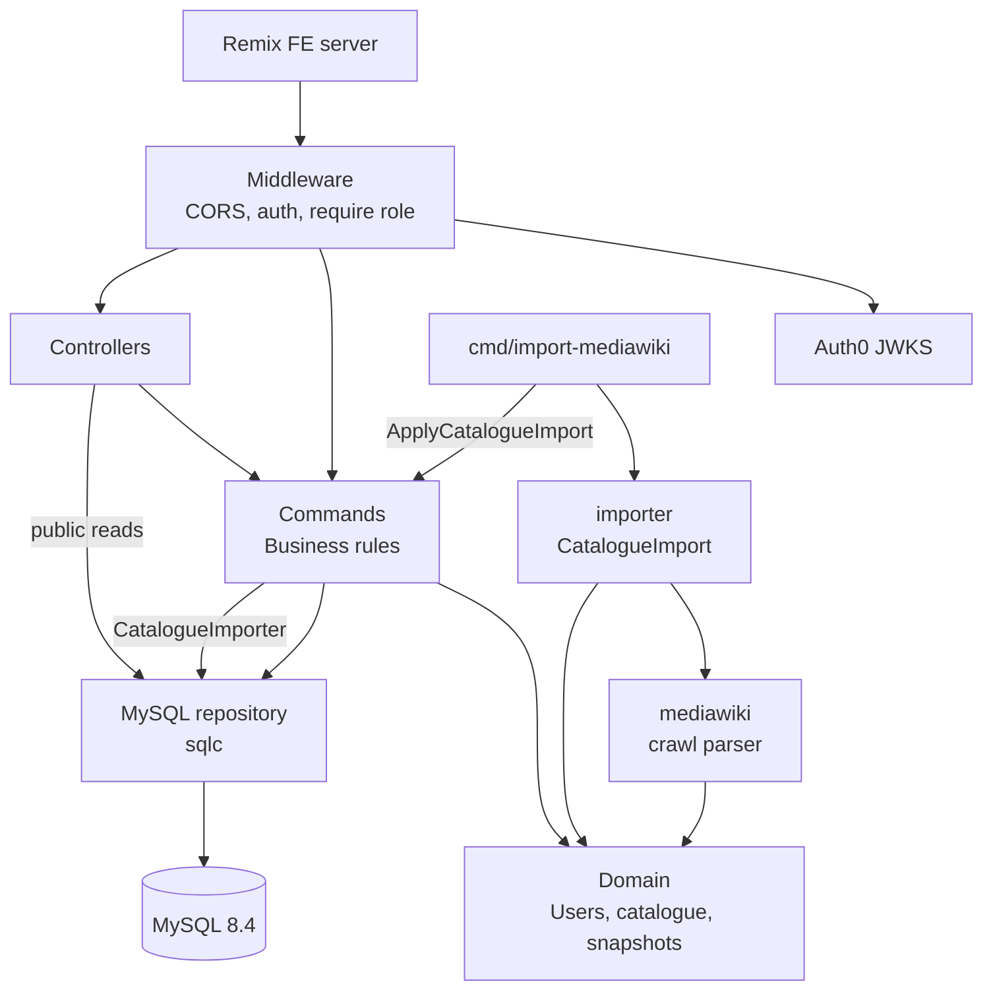

# Bardic Torch API

A Go REST API for Bardic Torch, a public, community-edited index of SCA bardic pieces and the bards who wrote or
perform them. The Remix frontend (bardic-torch-fe) calls it server-side; it stores users and roles in MySQL and
authenticates users through Auth0 (Google and Facebook login). [docs/PLAN.md](docs/PLAN.md) is
the product and implementation plan.

## Key Concepts

- **User** -- Created on a user's first authenticated request, keyed by their Auth0 user ID (e.g.
  `google-oauth2|1234`; case and trailing spaces are significant), with a display name they can change
  (`Bard <hash>` until they do). Display names are NFC-normalised and trimmed, and may contain only letters,
  marks, numbers, punctuation, symbols and spaces.
- **Role** -- Every user is a contributor or a moderator. Moderators are named in `BOOTSTRAP_MODERATOR_USER_IDS`
  and promoted at startup; removing an ID never demotes (see PLAN §4 and §5).
- **Blocking** -- Moderators can block contributors. A blocked user gets 403 `user_blocked` on every
  authenticated endpoint. Moderators cannot be blocked.
- **Principal** -- The authenticated user, resolved once per request by the auth middleware before any
  authorisation check.
- **Piece** -- A bardic song, poem, story, dance tune, instrumental or comedy piece, addressed by slug. It has a
  primary kind plus optional secondary kinds, a conservation status, licensing information, aliases (other titles),
  credits, relations to other pieces, links and term tags. A stub is a piece with little recorded yet.
- **Person** -- A community bard, historical author or group, addressed by slug, with aliases, roles, affiliations,
  relations, links, the works they are credited on and the performances they appear in. A person with status
  `prefers_no_page` shows only their identity: they are listed as a stub, found only by name, and omitted from
  credits, member lists, counts and needs-work.
- **Term and facet** -- Terms classify pieces (and, for the `affiliation` facet, persons). Each belongs to one facet
  (mood, topic, culture, language, legendaria, form, origin, other, affiliation) and may have a parent, up to three
  levels deep. Filtering by a term matches pieces tagged with it or any descendant. Within a facet terms combine
  with OR, across facets with AND. Piece kind and conservation status act as two more facets.
- **Collection** -- A website or archive that hosts bardic material, addressed by numeric ID, with the links cited
  from it.
- **Event** -- An event or venue where pieces were performed, addressed by slug.
- **Link** -- An external URL attached to pieces or persons with one or more roles (lyrics, sheet music,
  performance...). Moderators can hide a link, and hidden links appear in no public read.
- **Revision and visibility** -- Every change to a catalogue entity is a revision. An entity is public only once it
  has an approved current revision (a term also needs every ancestor approved); anything else, and anything unknown,
  gets the same 404. Only approved revisions appear in the public history, as redacted views using current
  visibility, with the fields that changed.
- **Null Auth** -- With `AUTH_DRIVERS` empty, every request is anonymous, so the API runs locally without Auth0.

## Architecture Overview

The codebase follows a layered architecture: the transport layer handles HTTP, the command layer implements
business rules over small datasource interfaces, the domain layer defines core types, and the MySQL datasource
implements those interfaces with sqlc. The legacy wiki importer adds two layers below the command layer:
`internal/mediawiki` reads and parses the crawl, and `internal/importer` maps it onto a domain `CatalogueImport`.
`cmd/import-mediawiki` validates the import and applies it through the `ApplyCatalogueImport` command, which
writes it with the `CatalogueImporter` datasource in one transaction.



The public catalogue reads are registered outside the authentication middleware, so they answer every request as
an anonymous one. Faceted piece, person and collection lists are built in Go from fixed SQL fragments (sqlc cannot
express optional filters) and use InnoDB FULLTEXT for `q`. Every `SELECT` the API runs
is capped by a session `max_execution_time` of 2 s (see [docs/DEPLOY.md](docs/DEPLOY.md)); a list the server
stops for that answers 500 `internal`.

Three entrypoints share the internal packages:

| Entrypoint | Purpose |
|---|---|
| `cmd/app/` | HTTP API server. At startup it promotes the bootstrap moderators. |
| `cmd/migrate/` | Applies (`up`), rolls back (`down N`) or reports (`version`) the embedded schema migrations; dokku runs `migrate up` before every deploy, which applies nothing on a clean schema newer than its migrations (a rollback) |
| `cmd/import-mediawiki/` | Imports the crawl of the legacy wiki (PLAN §7): `--dry-run` builds and validates the import without a database; `--apply` writes it, once, into the empty catalogue at `DATABASE_URL` in one transaction ([docs/DEPLOY.md](docs/DEPLOY.md), "Importing the legacy wiki") |

## Getting Started

### Prerequisites

- Go 1.27.4+ (`GOTOOLCHAIN=auto` fetches it)
- podman (or docker, with `CONTAINER_ENGINE=docker`) for the development MySQL
- Make

Tools (golangci-lint, vacuum, sqlc, govulncheck) are pinned in `go.mod` and run with `go tool`; nothing needs
installing.

### Quick start

```
make db-up
cp .env.dist .env
make run
```

`make db-up` starts MySQL 8.4 on `127.0.0.1:3306` with the credentials in `.env.dist`'s `DATABASE_URL`. `make
run` applies the migrations and starts the API on port 5000 with null auth, so `curl localhost:5000/readyz` returns
200 and the authenticated `/v1` endpoints return 401 (the public catalogue reads work, and are empty until data is imported). `make db-down` removes the database. `make help` lists every target.

### Common Commands

| Command | Description |
|---|---|
| `make validate` | Format check, lint, OpenAPI lint, unit tests, build and generated-code check |
| `make test-integration` | Integration tests against a throwaway podman MySQL ([docs/TESTING.md](docs/TESTING.md) has the other modes) |
| `make vulncheck` | govulncheck: known vulnerabilities reachable from the code (needs network access to vuln.go.dev) |
| `make fmt` | Format code (gofmt + goimports) |
| `make generate` | Regenerate sqlc queries |
| `make docker-build` | Build the production image |

## External Dependencies

| Service | Purpose | Required |
|---|---|---|
| MySQL 8.4 | Users, roles and the catalogue (pieces, persons, terms, collections, events, links, revisions) | Yes |
| Auth0 | Verifies the FE's access tokens (Google and Facebook login) | No (`AUTH_DRIVERS=` for null auth) |

Production runs on dokku with the dokku mysql plugin; [docs/DEPLOY.md](docs/DEPLOY.md) covers setup, Auth0,
deploys, migrations and moderators.

## API Reference

The full API is documented in the [OpenAPI spec](openapi/api.yaml).

| Method | Path | Auth | Description |
|---|---|---|---|
| `GET` | `/healthz` | No | Liveness |
| `GET` | `/readyz` | No | Readiness: the database answers |
| `GET` | `/v1/pieces` | No | Faceted piece search: `term`, `kind`, `conservation_status`, `stub`, `q`, `letter`, `sort`, with facet and A-Z counts |
| `GET` | `/v1/pieces/{slug}` | No | A piece |
| `GET` | `/v1/pieces/{slug}/history` | No | A piece's approved revisions, newest first |
| `GET` | `/v1/persons` | No | Persons: `kind`, `role`, `affiliation`, `q`, `letter`, `sort` |
| `GET` | `/v1/persons/{slug}` | No | A person |
| `GET` | `/v1/persons/{slug}/history` | No | A person's approved revisions |
| `GET` | `/v1/terms` | No | The term tree with piece and person counts (`facet` filter) |
| `GET` | `/v1/terms/{slug}` | No | A term with its ancestors, children and a page of its pieces or persons |
| `GET` | `/v1/terms/{slug}/history` | No | A term's approved revisions |
| `GET` | `/v1/collections` | No | Collections: `kind`, `letter` |
| `GET` | `/v1/collections/{collection_id}` | No | A collection with its children and citations |
| `GET` | `/v1/collections/{collection_id}/history` | No | A collection's approved revisions |
| `GET` | `/v1/events` | No | Events and venues |
| `GET` | `/v1/events/{slug}` | No | An event with its performances |
| `GET` | `/v1/events/{slug}/history` | No | An event's approved revisions |
| `GET` | `/v1/revisions/{revision_id}` | No | An approved revision: redacted snapshot, base snapshot and changed fields |
| `GET` | `/v1/needs-work` | No | Stub, unassessed, unknown-licensing and dead-link pieces and persons, with a count per reason |
| `GET` | `/v1/me` | Required | The caller's user |
| `PATCH` | `/v1/me` | Required | Change the caller's display name |
| `PUT` | `/v1/users/{user_id}/blocked` | Moderator | Block or unblock a contributor |

Catalogue reads ignore credentials: an invalid or expired token gets the same answer as no token. Paged lists (all but `/v1/terms`, which returns the whole tree) take
`limit` (1-100, default 50) and `offset` (0-10000) and return `total`; every list order ends with an internal ID, so pages
of an unchanged catalogue concatenate; nested lists that grow with data are capped at 200
with a `*_total`. Query parameters are single-valued unless documented as repeatable, and a repeated or badly
encoded one is a 400.

Any other path gets a JSON 404 (`not_found`), and a listed path with another method a JSON 405
(`method_not_allowed`) with an `Allow` header; neither authenticates. Request headers over 16 KiB get a plain-text
431.

### Authentication

Auth0 is the only method: `Authorization: Bearer <access_token>`, an Auth0 access token for the audience
`https://api.bardictorch.org`. With `AUTH_DRIVERS` empty the API runs with null auth and every request is anonymous.
