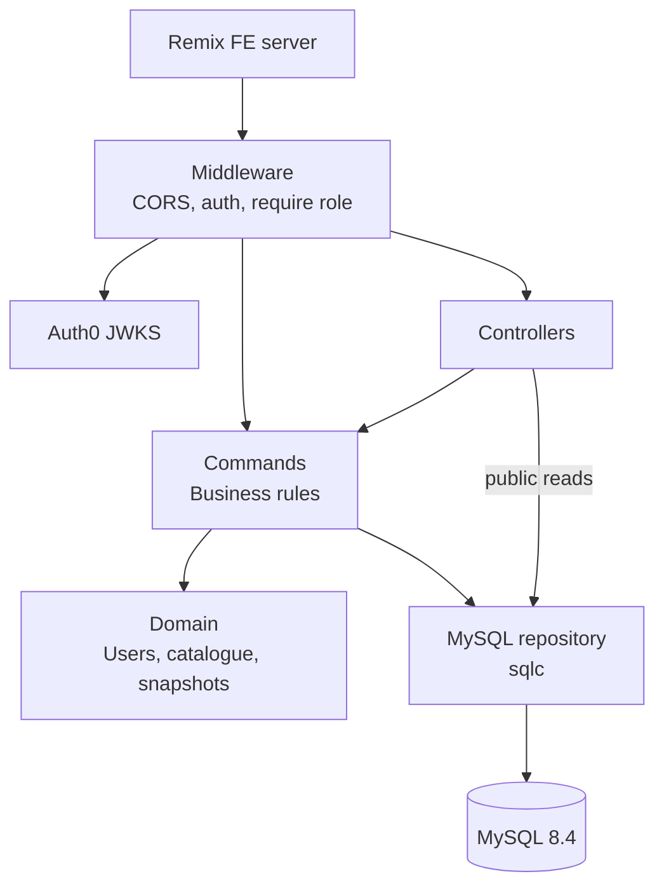

# Bardic Torch API

A Go REST API for Bardic Torch, a public, community-edited index of SCA bardic pieces and the bards who wrote or
perform them. The Remix frontend (bardic-torch-fe) calls it server-side; it stores users and roles in MySQL and
authenticates users through Auth0 (Google and Facebook login). [docs/PLAN.md](docs/PLAN.md) is
the product and implementation plan.

## Key Concepts

- **User** -- Created on a user's first authenticated request, keyed by their Auth0 user ID (e.g.
  `google-oauth2|1234`; case and trailing spaces are significant), with the display name
  their access token carries (the `https://bardictorch.org/name` claim, which an Auth0 post-login Action sets
  from Google or Facebook). A stored name that differs is replaced on the next request; users cannot set their
  own. Display names keep only letters, marks, numbers, punctuation, symbols and spaces (others, such as zero-width
  joiners and direction marks, are dropped), are NFC-normalised, trimmed and cut to 64 characters; a token without
  a valid name left gets 401.
- **Role** -- Every user is a contributor or a moderator. Moderators are named in `BOOTSTRAP_MODERATOR_USER_IDS`
  and promoted at startup; removing an ID never demotes (see PLAN §4 and §5).
- **Blocking** -- Moderators can block contributors. A blocked user gets 403 `user_blocked` on every
  authenticated endpoint. Moderators cannot be blocked.
- **Principal** -- The authenticated user, resolved once per request by the auth middleware before any
  authorisation check.
- **Null Auth** -- With `AUTH_DRIVERS` empty, every request is anonymous, so the API runs locally without Auth0.

## Architecture Overview

The codebase follows a layered architecture: the transport layer handles HTTP, the command layer implements
business rules over small datasource interfaces, the domain layer defines core types, and the MySQL datasource
implements those interfaces with sqlc.



| Entrypoint | Purpose |
|---|---|
| `cmd/app/` | HTTP API server. At startup it promotes the bootstrap moderators. |
| `cmd/migrate/` | Applies (`up`), rolls back (`down N`) or reports (`version`) the embedded schema migrations; dokku runs `migrate up` before every deploy, which applies nothing on a clean schema newer than its migrations (a rollback) |

## Getting Started

### Prerequisites

- Go 1.27.4+ (`GOTOOLCHAIN=auto` fetches it)
- podman (or docker, with `CONTAINER_ENGINE=docker`) for the development MySQL
- Make

Tools (golangci-lint, vacuum, sqlc, govulncheck) are pinned in `go.mod` and run with `go tool`; nothing needs
installing.

### Quick start

```
make db-up
cp .env.dist .env
make run
```

`make db-up` starts MySQL 8.4 on `127.0.0.1:3306` with the credentials in `.env.dist`'s `DATABASE_URL`. `make
run` applies the migrations and starts the API on port 5000 with null auth, so `curl localhost:5000/readyz` returns
200 and the authenticated `/v1` endpoints return 401 `make db-down` removes the database. `make help` lists every target.

### Common Commands

| Command | Description |
|---|---|
| `make validate` | Format check, lint, OpenAPI lint, unit tests, build and generated-code check |
| `make test-integration` | Integration tests against a throwaway podman MySQL ([docs/TESTING.md](docs/TESTING.md) has the other modes) |
| `make vulncheck` | govulncheck: known vulnerabilities reachable from the code (needs network access to vuln.go.dev) |
| `make fmt` | Format code (gofmt + goimports) |
| `make generate` | Regenerate sqlc queries |
| `make docker-build` | Build the production image |

## External Dependencies

| Service | Purpose | Required |
|---|---|---|
| MySQL 8.4 | Users, roles | Yes |
| Auth0 | Verifies the FE's access tokens (Google and Facebook login) | No (`AUTH_DRIVERS=` for null auth) |

Production runs on dokku with the dokku mysql plugin; [docs/DEPLOY.md](docs/DEPLOY.md) covers setup, Auth0,
deploys, migrations and moderators.

## API Reference

The full API is documented in the [OpenAPI spec](openapi/api.yaml).

| Method | Path | Auth | Description |
|---|---|---|---|
| `GET` | `/healthz` | No | Liveness |
| `GET` | `/readyz` | No | Readiness: the database answers |
| `GET` | `/v1/me` | Required | The caller's user |
| `PUT` | `/v1/users/{user_id}/blocked` | Moderator | Block or unblock a contributor |

Any other path gets a JSON 404 (`not_found`), and a listed path with another method a JSON 405
(`method_not_allowed`) with an `Allow` header; neither authenticates. Request headers over 16 KiB get a plain-text
431.

### Authentication

Auth0 is the only method: `Authorization: Bearer <access_token>`, an Auth0 access token for the audience
`https://api.bardictorch.org` that carries the user's name in the `https://bardictorch.org/name` claim
([docs/DEPLOY.md](docs/DEPLOY.md), "Name claim"). With `AUTH_DRIVERS` empty the API runs with null auth and every request is anonymous.
