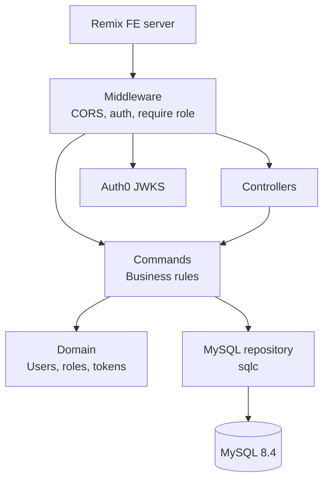

# Bardic Torch API

A Go REST API for Bardic Torch, a public, community-edited index of SCA bardic pieces and the bards who wrote or
perform them. The Remix frontend (bardic-torch-fe) calls it server-side; it stores users, roles and personal API
tokens in MySQL and authenticates users through Auth0 (Google and Facebook login). [docs/PLAN.md](docs/PLAN.md) is
the product and implementation plan.

## Key Concepts

- **User** -- Created on a user's first authenticated request, keyed by their case-sensitive Auth0 user ID (e.g.
  `google-oauth2|1234`), with a display name they can change (`Bard <hash>` until they do).
- **Role** -- Every user is a contributor or a moderator. Moderators are named in `BOOTSTRAP_MODERATOR_USER_IDS`
  and promoted at startup; removing an ID never demotes (see PLAN §4 and §5).
- **Blocking** -- Moderators can block contributors. A blocked user gets 403 `user_blocked` on every
  authenticated endpoint. Moderators cannot be blocked.
- **Principal** -- The authenticated user and how they authenticated (Auth0 or API token), resolved once per
  request by the auth middleware before any authorisation check.
- **API Token** -- A user-created bearer token (`user_api|…`) for programmatic access, stored as a SHA-256 hash, at
  most 10 active per user. Tokens cannot manage tokens; only Auth0 sessions can.
- **Null Auth** -- With `AUTH_DRIVERS` empty, every request is anonymous, so the API runs locally without Auth0.

## Architecture Overview

The codebase follows a layered architecture: the transport layer handles HTTP, the command layer implements
business rules over small datasource interfaces, the domain layer defines core types, and the MySQL datasource
implements those interfaces with sqlc.



Two entrypoints share the internal packages:

| Entrypoint | Purpose |
|---|---|
| `cmd/app/` | HTTP API server. At startup it promotes the bootstrap moderators. |
| `cmd/migrate/` | Applies (`up`), rolls back (`down N`) or reports (`version`) the embedded schema migrations; dokku runs `migrate up` before every deploy |

## Getting Started

### Prerequisites

- Go 1.27.3+ (`GOTOOLCHAIN=auto` fetches it)
- podman (or docker, with `CONTAINER_ENGINE=docker`) for the development MySQL
- Make

Tools (golangci-lint, vacuum, sqlc, mockery) are pinned in `go.mod` and run with `go tool`; nothing needs
installing.

### Quick start

```
make db-up
cp .env.dist .env
make run
```

`make db-up` starts MySQL 8.4 on `127.0.0.1:3306` with the credentials in `.env.dist`'s `DATABASE_URL`. `make
run` applies the migrations and starts the API on port 5000 with null auth, so `curl localhost:5000/readyz` returns
200 and `/v1` endpoints return 401. `make db-down` removes the database. `make help` lists every target.

### Common Commands

| Command | Description |
|---|---|
| `make validate` | Format check, lint, OpenAPI lint, unit tests, build and generated-code check |
| `make test-integration` | Integration tests against a throwaway podman MySQL ([docs/TESTING.md](docs/TESTING.md) has the other modes) |
| `make fmt` | Format code (gofmt + goimports) |
| `make generate` | Regenerate sqlc queries and mockery mocks |
| `make docker-build` | Build the production image |

## External Dependencies

| Service | Purpose | Required |
|---|---|---|
| MySQL 8.4 | Users, roles and API tokens | Yes |
| Auth0 | Verifies the FE's access tokens (Google and Facebook login) | No (`AUTH_DRIVERS=` for null auth) |

Production runs on dokku with the dokku mysql plugin; [docs/DEPLOY.md](docs/DEPLOY.md) covers setup, Auth0,
deploys, migrations and moderators.

## API Reference

The full API is documented in the [OpenAPI spec](openapi/api.yaml).

| Method | Path | Auth | Description |
|---|---|---|---|
| `GET` | `/healthz` | No | Liveness |
| `GET` | `/readyz` | No | Readiness: the database answers |
| `GET` | `/v1/me` | Required | The caller's user |
| `PATCH` | `/v1/me` | Required | Change the caller's display name |
| `PUT` | `/v1/users/{user_id}/blocked` | Moderator | Block or unblock a contributor |
| `GET` | `/v1/tokens` | Auth0 only | List the caller's active API tokens |
| `POST` | `/v1/tokens` | Auth0 only | Create an API token (max 10 active) |
| `DELETE` | `/v1/tokens/{token_id}` | Auth0 only | Revoke an API token |

Any other path gets a JSON 404 (`not_found`), and a listed path with another method a JSON 405
(`method_not_allowed`) with an `Allow` header; neither authenticates. Request headers over 16 KiB get a plain-text
431.

### Authentication

Two authentication methods are supported, identified by the bearer token prefix:

- **Auth0:** `Authorization: Bearer auth0|<access_token>`, an Auth0 access token for the audience
  `https://api.bardictorch.org`. Can access every endpoint the user's role allows.
- **API Token:** `Authorization: Bearer user_api|<token>`. Cannot manage tokens.
